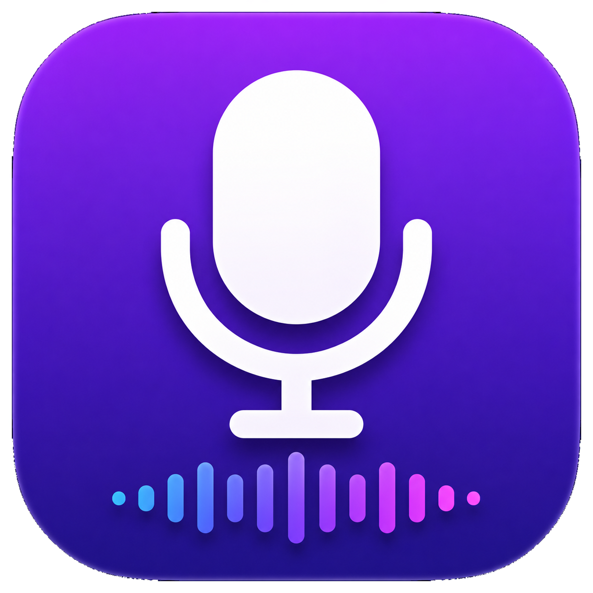

# VoiceCal

# تقویم قرار با فرمان صوتی فارسی

اپلیکیشن اندرویدی برای ثبت قرار ملاقات ها و یادآوری ها با **فرمان صوتی فارسی**.   
استخراج خودکار تاریخ/ساعت/محل/شخص/موضوع، از توضیحات صوتی بیان شده، پیش‌نمایش **قابل‌ویرایش** برای تایید، ذخیره در دیتابیس محلی همراه با فایل صوتی، **یادآوری خودکار قبل از قرار**، و نمایش لیست گروه‌بندی‌شده با قابلیت پخش صدا و حذف.

 

## ✨ ویژگی‌ها

### 🎙️ ثبت صدا
- دکمه‌ی **«Start Talk»**: با نگه‌داشتن، ضبط شروع می‌شود؛ با رهاکردن، متوقف و پردازش می‌شود.
- انیمیشن پالس‌دار میکروفون حین ضبط.
- معماری ضبط ترتیبی (نه هم‌زمان با تشخیص گفتار) برای پایداری کامل ضبط صدا.

### 🧠 تشخیص گفتار فارسی — دو حالت قابل‌انتخاب
- **آنلاین (رایگان، پیش‌فرض):** با مدل **Whisper Large v3** روی Groq — دقیق‌ترین مدل خانواده‌ی Whisper.
- **آفلاین:** با موتور **Vosk** روی خود گوشی، بدون نیاز به اینترنت.
- جابه‌جایی بین دو حالت از قسمت تنظیمات داخل اپ.

### 🤖 استخراج هوشمند اطلاعات قرار ملاقات
- در حالت آنلاین، با مدل زبانی **openai/gpt-oss-120b** تاریخ، ساعت، محل، شخص و موضوع به‌طور خودکار از جمله‌ی گفته‌شده استخراج می‌شوند.
- درک تاریخ‌های نسبی («امروز»، «امشب»، «فردا»، «پس‌فردا»، «N روز دیگر») و تبدیل خودکار به تقویم شمسی.
- درک روزهای نوشته‌شده با کلمه («هفتم شهریور») و روزهای هفته بدون تاریخ صریح («سه‌شنبه» → نزدیک‌ترین سه‌شنبه‌ی پیش رو).
- درک ساعت‌های محاوره‌ای («یازده و ربع»، «نه و نیم»، «شش عصر») حتی بدون کلمه‌ی «ساعت».
- تفکیک درست نام شخص از نام محل، و تصحیح خودکار خطاهای رایج تشخیص گفتار با کمک دانش زبانی مدل.
- رد خودکار تاریخ‌های گذشته (چون کاربر معمولاً برای قرار گذشته صدا ضبط نمی‌کند) و پیش‌فرض‌گذاری سال جاری وقتی فقط ماه/روز گفته شده.
- محاسبه‌ی همیشه‌درستِ روز هفته مستقیماً از روی تاریخ شمسی (نه صرفاً گفتار).

### ✅ پیش‌نمایش و ویرایش قبل از ذخیره
- بعد از پردازش صدا، فیلدهای استخراج‌شده در یک فرم کاملاً قابل‌ویرایش نمایش داده می‌شوند.
- امکان اصلاح دستی هر فیلد قبل از تایید نهایی.
- نمایش متن خام شنیده‌شده برای مرجع.

### 💾 ذخیره‌سازی محلی و امن
- تمام قرار ملاقات‌ها در یک دیتابیس محلی (Room) روی خود گوشی ذخیره می‌شوند.
- فایل صوتی اصلی هر قرار به‌طور کامل نگه داشته می‌شود و از داخل لیست قابل پخش است.
- بدون وابستگی به سرور یا حساب کاربری؛ داده‌ها فقط روی دستگاه خودتان هستند.

### 📋 نمایش و مدیریت
- دو تب مجزا: **«آینده»** (گروه‌بندی‌شده زیر امروز/فردا/این هفته/به‌زودی) و **«گذشته»** (مرتب‌شده از جدیدترین به قدیمی‌ترین).
- پخش/توقف صدای هر قرار مستقیماً از داخل لیست.
- **ویرایش** هر قرار ثبت‌شده بدون نیاز به ضبط دوباره.
- **حذف** با قابلیت «واگرد» (Undo) چند ثانیه‌ای.
- جهت نمایش همیشه راست‌به‌چپ (RTL)، مستقل از زبان سیستم گوشی.

### 🔔 یادآوری و آلارم هوشمند
- یادآوری خودکار ۳۰ دقیقه پیش از هر قرار، حتی بعد از ریستارت گوشی.
- امکان فعال/غیرفعال‌کردن کامل آلارم از تنظیمات.
- انتخاب آهنگ دلخواه برای آلارم + تنظیم مدت زمان پخش (۳ تا ۱۲۰ ثانیه).
- زنجیره‌ی جایگزین هوشمند صدا (اگر آهنگ انتخابی پخش نشد، خودکار سراغ صدای پیش‌فرض می‌رود).
- گزینه‌ی خروج از بهینه‌سازی باتری برای افزایش قابلیت‌اطمینان آلارم روی گوشی‌های سخت‌گیر (شیائومی/هواوی/سامسونگ).
- نوتیفیکیشن یادآوری در صورت پایان‌یافتن مدت آلارم بدون واکنش کاربر، به‌صورت عادی و قابل‌کشیدن باقی می‌ماند تا کاربر بعداً ببیندش.

### 🎨 طراحی و تجربه‌ی کاربری
- رابط کاربری کاملاً فارسی و راست‌به‌چپ.
- پشتیبانی خودکار از حالت تیره (Dark Mode).
- طراحی مدرن با گرادیان رنگی و انیمیشن‌های روان (Jetpack Compose).
- پیام‌های بازخورد کوتاه و واضح برای هر عملیات.

### 🔒 حریم خصوصی
- تمام داده‌ها فقط به‌صورت محلی روی گوشی ذخیره می‌شوند.
- در حالت آنلاین، فقط صدا/متن برای پردازش به Groq فرستاده می‌شود؛ کلید API فقط روی همان گوشی نگه داشته می‌شود.
- در حالت آفلاین، هیچ داده‌ای هرگز از گوشی خارج نمی‌شود.

 

## 🌐 راه‌اندازی تشخیص گفتار آنلاین (پیش‌فرض — رایگان)

1. به [console.groq.com](https://console.groq.com) بروید و با ایمیل یا حساب گوگل ثبت‌نام کنید.
2. از صفحه‌ی [console.groq.com/keys](https://console.groq.com/keys) یک کلید API جدید بسازید (با `gsk_` شروع می‌شود).
3. داخل اپ، روی آیکون ⚙ بالای صفحه‌ی اصلی بزنید، حالت **«آنلاین (Groq — رایگان)»** را انتخاب کنید، کلید را در فیلد مربوطه وارد و **ذخیره** کنید.
4. همین! کلید فقط به‌صورت محلی روی گوشی خودتان ذخیره می‌شود (هیچ‌جای دیگری فرستاده نمی‌شود). Groq در پلن رایگان روزانه حدود ۲۰۰۰ درخواست تشخیص گفتار اجازه می‌دهد که برای استفاده‌ی شخصی کاملاً کافی است.
اگر سرویس‌های Groq در شبکه‌ی شما فیلتر است، فعال‌کردن فیلترشکن هنگام ارسال صدا (بعد از رهاکردن دکمه) کافی است — چون این‌بار ضبط و ارسال دو مرحله‌ی جدا هستند، مشکل «سکوت» قبلی دیگر تکرار نمی‌شود.
 

## 🔐 دسترسی‌های لازم

| دسترسی | کاربرد | زمان درخواست / توضیحات |
|---|---|---|
| 🎙️ `RECORD_AUDIO` | ضبط صدای کاربر برای تبدیل گفتار به متن و ایجاد قرار ملاقات صوتی | هنگام استفاده از قابلیت ضبط صدا، از کاربر درخواست می‌شود. |
| 🌐 `INTERNET` | ارتباط با سرویس‌های آنلاین گفتار-به-متن و هوش مصنوعی در حالت آنلاین | فقط هنگام استفاده از قابلیت‌های آنلاین مورد نیاز است. در حالت آفلاین، تشخیص گفتار می‌تواند بدون اینترنت انجام شود. |
| 🔔 `POST_NOTIFICATIONS` | نمایش اعلان‌های مربوط به یادآوری قرارها | در اندروید 13 و بالاتر هنگام نیاز درخواست می‌شود. رد کردن این دسترسی مانع استفاده از سایر قابلیت‌های برنامه نمی‌شود، اما اعلان یادآوری نمایش داده نخواهد شد. |
| ⏰ `SCHEDULE_EXACT_ALARM` | زمان‌بندی دقیق یادآوری قرارها در زمان تعیین‌شده | برای عملکرد دقیق اعلان ها در نسخه‌های جدید اندوریدها مورد استفاده قرار می‌گیرد. |
| 🔄 `RECEIVE_BOOT_COMPLETED` | زمان‌بندی مجدد یادآوری‌ها پس از راه‌اندازی مجدد گوشی | اندورید پس از ری استارت برخی آلارمهای زمان‌بندی‌شده را حذف می‌کند؛ اپلیکیشن پس از راه‌اندازی مجدد، یادآوری‌ها را دوباره تنظیم می‌کند. |
| 🔋 `REQUEST_IGNORE_BATTERY_OPTIMIZATIONS` | کمک به جلوگیری از متوقف شدن اعلانها توسط محدودیت‌های شدید مصرف باتری برخی دستگاه‌ها | برای بهبود قابلیت اطمینان یادآوری‌ها در دستگاه‌هایی که محدودیت شدید بهینه سازی باتری دارند استفاده می‌شود. |
